<p align="center">
  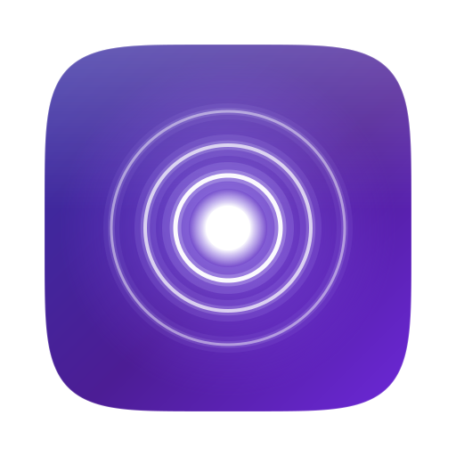
</p>

<h1 align="center">Auracaster</h1>

<p align="center">
  <b>Der Ton deines Mac als Auracast™-Broadcast – an beliebig viele Hörgeräte, Kopfhörer und Lautsprecher gleichzeitig.</b><br>
  Native macOS-App · Bluetooth LE Audio · LC3 · Ziel: ≈ 20 ms Latenz · Open Source
</p>

<p align="center">
  <a href="https://github.com/thegroovex/Auracaster/releases/latest/download/Auracaster-macOS.dmg"></a>
</p>
<p align="center">
  <a href="https://github.com/thegroovex/Auracaster/releases/latest">Alle Downloads &amp; Dongle-Firmware</a> ·
  <a href="#installation-schritt-für-schritt">Installation</a> ·
  <a href="#häufige-fragen--fehlerbehebung">Hilfe</a> ·
  <a href="#english-summary">English</a>
</p>

<p align="center">
  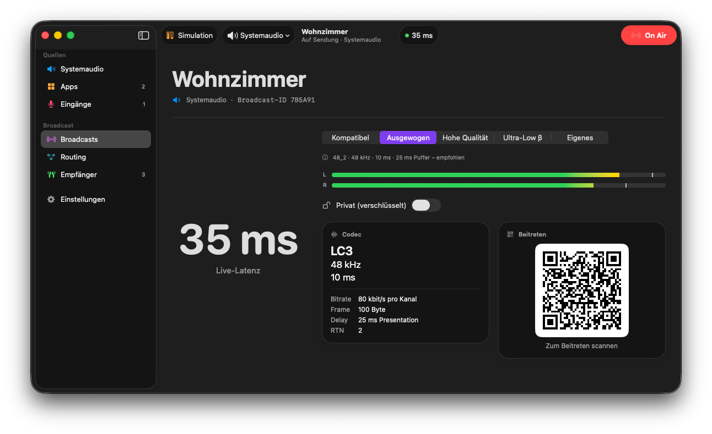
</p>

> **Status: frühe Version (0.1.2).** App, Updater, Installer, Dongle-Assistent und Dongle-Firmware sind fertig und werden automatisch gebaut.
> Der Funkpfad (Mac → Dongle → Empfänger) wird gerade auf echter Hardware getestet. Was schon geht und was nicht, steht
> ehrlich in den Tabellen unten.

---

## Was macht Auracaster?

**Auracast™** ist der neue Bluetooth-Standard für *Broadcast-Audio* (Teil von Bluetooth LE Audio): Ein Sender funkt,
und **beliebig viele** Empfänger in Reichweite hören zu – ohne Koppeln, ohne Begrenzung auf ein oder zwei Geräte.
Moderne Hörgeräte, viele aktuelle Earbuds (z. B. Galaxy Buds 2 Pro/3, Pixel Buds Pro 2, Sony WF-1000XM5/LinkBuds) und
Lautsprecher (z. B. JBL Charge 5 Wi-Fi/6, Flip 6/7 mit Auracast) können Auracast empfangen.

Der Mac selbst kann das (noch) nicht senden. **Auracaster** macht es möglich:

1. Die App nimmt **Systemaudio, einzelne Apps** (z. B. Musik, Ableton Live, Zoom) oder ein **Mikrofon/Audio-Interface** auf.
2. Sie kodiert das Audio mit **LC3**, dem Codec von LE Audio.
3. Ein winziger **USB-Dongle** (≈ 5 €) sendet es als Auracast-Broadcast.
4. Jeder in Reichweite wählt den Sender am Smartphone, in der Hörgeräte-App oder per **QR-Code** – fertig.

```
 Mac (Auracaster-App)  ──USB──▶  Dongle (nRF52840)  ))) Auracast )))  🦻 Hörgeräte  🎧 Kopfhörer  🔊 Lautsprecher  📱 …
```

## Die App

<table>
<tr>
<td width="50%">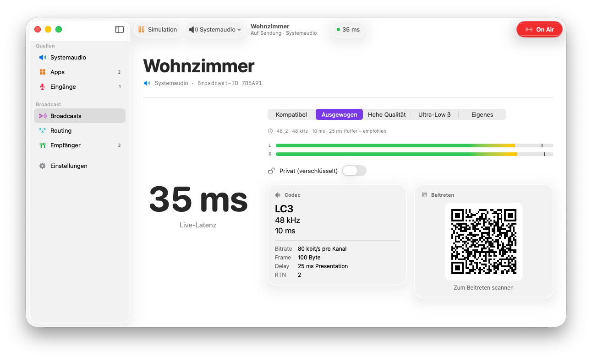<br><b>Studio</b> – Broadcast-Name, große Latenzanzeige, Preset, Pegel, Codec-Details und QR-Code zum Beitreten.</td>
<td width="50%">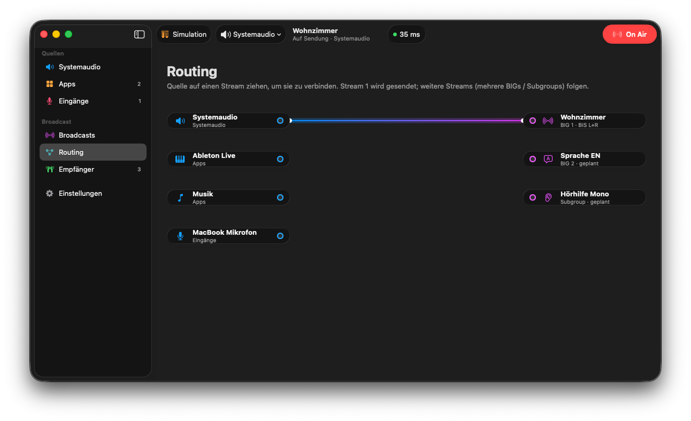<br><b>Routing-Matrix</b> – Quellen per Drag &amp; Drop auf Streams ziehen (Stream 1 sendet, 2 und 3 folgen).</td>
</tr>
<tr>
<td>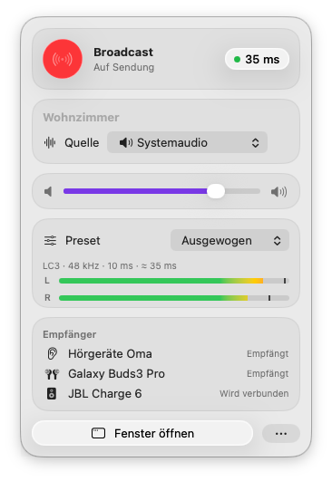<br><b>Menüleiste</b> – Senden, Quelle, Lautstärke und Preset im Stil des Kontrollzentrums, ohne das Fenster zu öffnen.</td>
<td>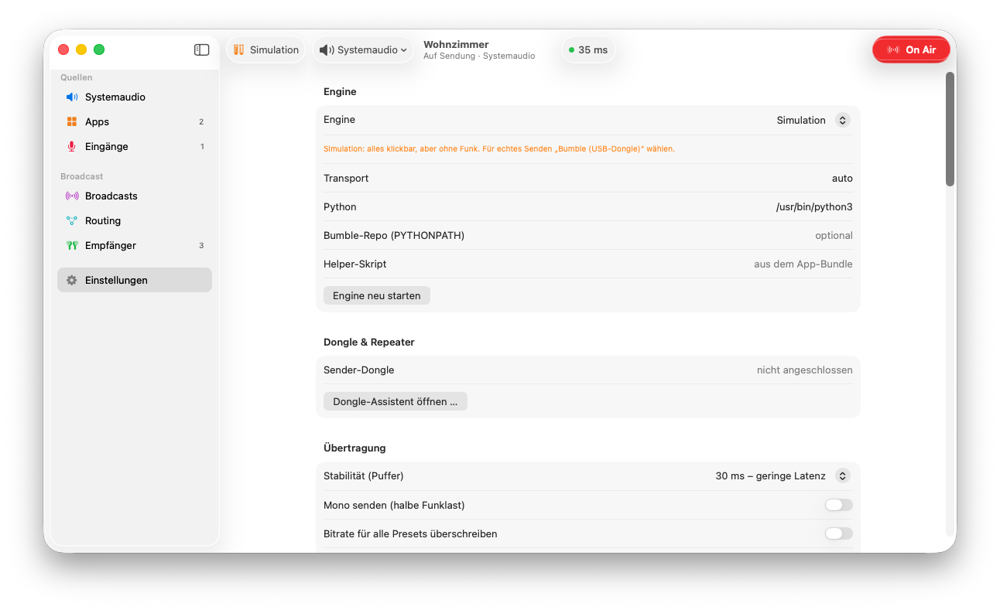<br><b>Einstellungen</b> – Engine, Dongle, Broadcast-Code/Sprache, Updates.</td>
</tr>
<tr>
<td>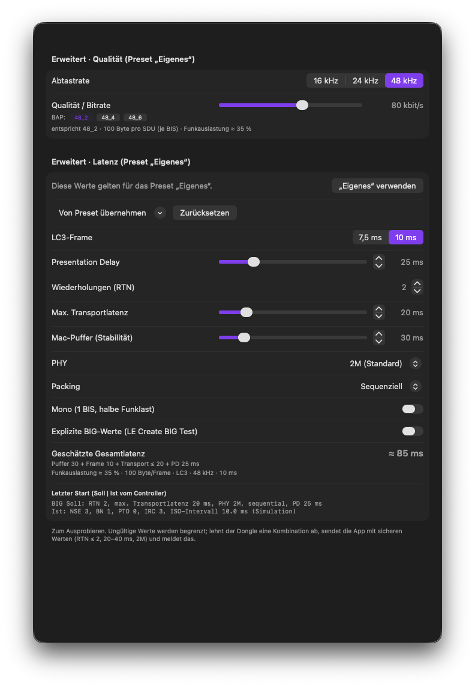<br><b>Preset „Eigenes“</b> – Bitrate (mit BAP-Stufen) getrennt von Latenz: Frame, Presentation Delay, RTN, Transportlatenz, Mac-Puffer, PHY, Packing, optional explizite BIG-Werte; geschätzte Gesamtlatenz und Warnungen live.</td>
<td>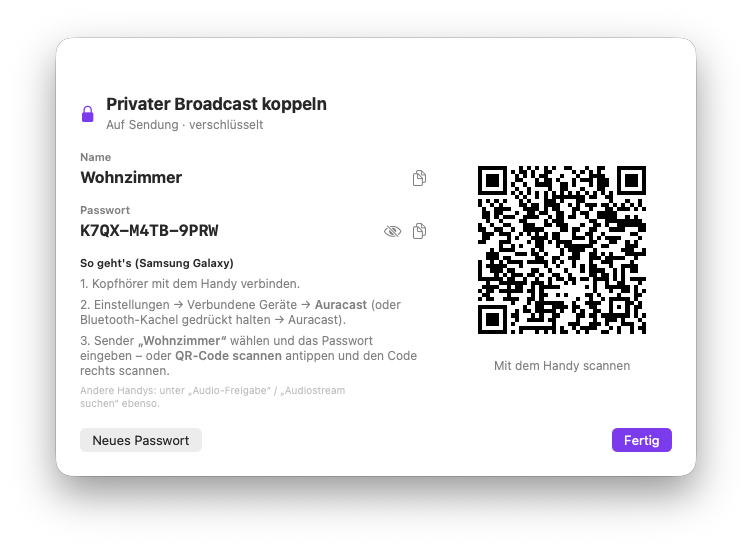<br><b>Private Broadcasts</b> – verschlüsselt mit Passwort (im Schlüsselbund), Kopplungsfenster mit Name, Passwort und Auracast-QR-Code zum Scannen mit dem Handy.</td>
</tr>
<tr>
<td>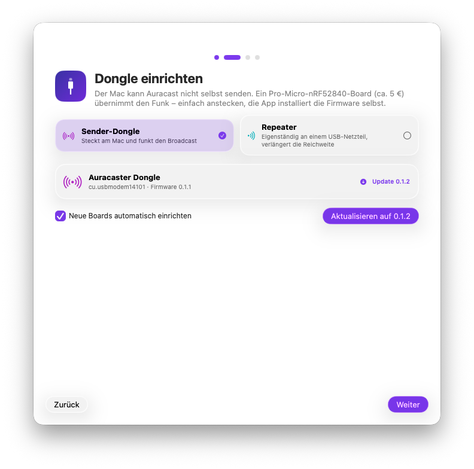<br><b>Willkommens-Assistent</b> – erkennt den Dongle live und richtet die Engine mit einem Klick ein.</td>
<td>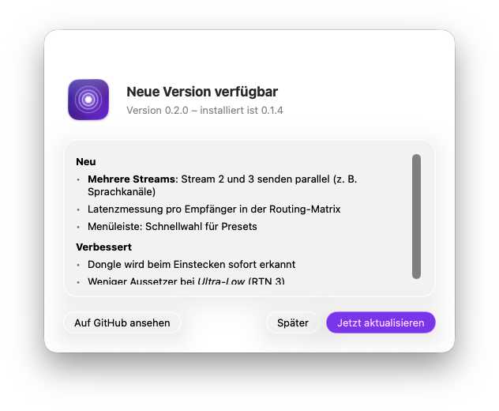<br><b>Eingebaute Updates</b> – prüft täglich auf neue Versionen und installiert sie ohne Gatekeeper-Ärger.</td>
</tr>
</table>

Gestaltet für macOS 26/27 („Golden Gate“): System-Liquid-Glass, einheitliche Toolbar, farbige Sidebar-Symbole, Hell- und Dunkelmodus.
Die Screenshots erzeugt die CI direkt aus der gebauten App (Screenshot-Modus mit Demo-Daten).

## Anwendungsfelder

| | Wofür | Wie |
|---|---|---|
| 🦻 | **Hörgeräte & Barrierefreiheit** | Fernseher, Film oder Videocall direkt in die Hörgeräte – in der eigenen Lautstärke, während alle anderen normal hören. |
| 🪩 | **Silent Disco / Party** | Ein DJ-Mac, beliebig viele Kopfhörer. Keine Pairing-Orgie, kein Limit auf zwei Geräte. |
| 🎛️ | **Studio-Monitoring / Ableton-Cue-Mix** | Band oder Sänger hören den Mix kabellos auf eigenen Earbuds; *Ultra-Low*-Preset für geringe Verzögerung. |
| ⛪ | **Vorträge, Gottesdienst, Museum, Führungen** | Saalton für Schwerhörige, später **mehrere Sprachkanäle** gleichzeitig (Deutsch/Englisch/…), jeder wählt seinen Kanal. |
| 🏋️ | **Fitnessstudio, Wartebereich, Bar** | Mehrere Bildschirme stumm, der Ton jeweils als eigener Auracast-Kanal aufs Smartphone/die Kopfhörer. |
| 🏠 | **Zuhause** | Spät abends fernsehen mit zwei oder mehr Kopfhörern, ohne die Nachbarn zu wecken. |

## Geringe Latenz

Damit Bild und Ton zusammenpassen (oder ein Musiker sich selbst in Echtzeit hört), zählt jede Millisekunde. Auracaster nutzt die
Stellschrauben von LE Audio direkt:

| Stellschraube | Was sie tut | In Auracaster |
|---|---|---|
| **LC3-Framelänge** | Wie viel Audio pro Paket gesammelt wird | 10 ms, experimentell 7,5 ms (*Ultra-Low β*) |
| **Presentation Delay** | Puffer, nach dem alle Empfänger synchron abspielen | einstellbar pro Preset: 10 / 25 / 40 ms |
| **RTN** (Retransmissions) | Wie oft jedes Paket wiederholt wird – mehr = robuster, aber mehr Funkzeit | 2 (seit 0.1.2 auch bei *Hohe Qualität*), *Ultra-Low* 3 |
| **Max. Transport Latency** | Obergrenze für den Funkweg beim BIG-Aufbau | 10 / 20 ms (*Ultra-Low* seit 0.1.3: 20 ms) |

| Preset | Format | Frame | Delay | Bitrate | Geschätzte Latenz* |
|---|---|---|---|---|---|
| **Kompatibel** | 24_2 (24 kHz) | 10 ms | 40 ms | 48 kbit/s | ≈ 50 ms – Pflichtformat, läuft auf jedem Auracast-Empfänger |
| **Ausgewogen** (Standard) | 48_2 | 10 ms | 25 ms | 80 kbit/s | ≈ 35 ms – im Realtest stabil |
| **Hohe Qualität** | 48_4 | 10 ms | 40 ms | 96 kbit/s | ≈ 50 ms – seit 0.1.2 mit RTN 2 (vorher zu viel Funklast für den Dongle) |
| **Ultra-Low β** | 48 kHz | 7,5 ms | 20 ms | 80 kbit/s | ≈ 28 ms – experimentell, seit 0.1.3 mit 20 ms Delay und RTN 3 (10 ms puffert auf Empfängern); nicht jeder Empfänger spielt 7,5 ms ab |

\* **Schätzung**, keine Messung: Framelänge + Presentation Delay. Dazu kommen ca. 30 ms Jitter-Puffer zwischen Mac-Aufnahme
und Funk (seit 0.1.1, verhindert Aussetzer) sowie die Verarbeitung im Empfänger. Echte Messwerte folgen.
Zum Vergleich: klassisches Bluetooth (A2DP) liegt meist bei 150–300 ms.

## Mehrere Streams

Auracast kann pro Sender mehrere Kanäle ausstrahlen (mehrere *BIS* in einer *BIG* bzw. Subgroups, z. B. pro Sprache).
Das Konzept in Auracaster: In der **Routing-Matrix** zieht man Quellen auf Streams – etwa „Saalmikro → Stream 1 (Deutsch)“,
„Dolmetscher-Mikro → Stream 2 (Englisch)“, „Musik-App → Stream 3“. Empfänger wählen ihren Kanal.

| | Stand |
|---|---|
| Stream 1 (Stereo L/R, eine Quelle) | ✅ implementiert (Hardware-Test läuft) |
| Routing-Matrix (UI, Drag &amp; Drop) | ✅ implementiert |
| Streams 2 und 3 (weitere Subgroups/BIGs, Sprachkennung) | 🚧 in Arbeit – die Firmware hat bereits Platz für 2 BIS |
| Verschlüsselung (Broadcast Code) | 🧪 vorbereitet, noch nicht mit Empfängern getestet |

## Was du brauchst

| | Was | Hinweise |
|---|---|---|
| 💻 | **Mac mit Apple-Chip (M1 oder neuer) und macOS 26 oder neuer** | Der LC3-Codec (lc3py) gibt es nur für Apple-Chips. Intel-Macs werden nicht unterstützt. |
| 🔌 | **Dongle: „Pro Micro nRF52840“** (nice!nano-v2-Klon, USB-C, ≈ 5 € pro Stück, z. B. Amazon/AliExpress) | Wird einmal mit unserer Firmware geflasht – per Drag &amp; Drop, ohne Programmiergerät. Details: [firmware/README.md](firmware/README.md). |
| 🖨️ | *optional:* 3D-gedrucktes Gehäuse | STL/3MF und Anleitung in [hardware/case/](hardware/case/README.md). |
| 🎧 | **Auracast-fähige Empfänger** | Beispiele: Hörgeräte mit LE Audio/Auracast (aktuelle Modelle von Phonak, Oticon, Signia, ReSound …), Samsung Galaxy Buds 2 Pro/3/3 Pro, Google Pixel Buds Pro 2, Sony WF-1000XM5/LinkBuds, JBL-Lautsprecher mit Auracast, Android-Smartphones mit Auracast-Empfang. Im Zweifel: Datenblatt nach „Auracast“ oder „LE Audio Broadcast“ durchsuchen. |
| 🌐 | Internet beim ersten Einrichten | Die App lädt einmalig Python, Bumble und LC3 (≈ 100 MB). |

<p align="center">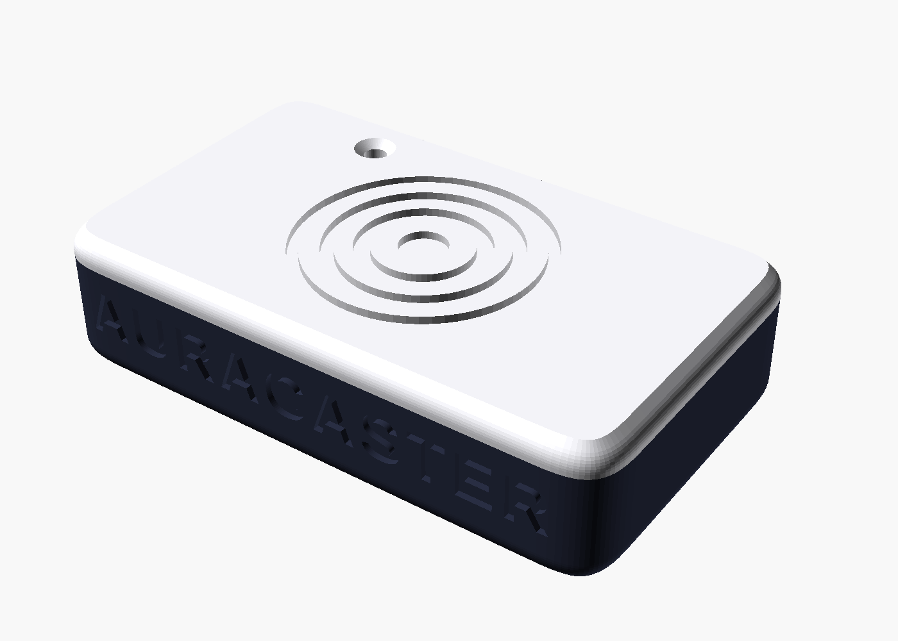</p>

## Installation Schritt für Schritt

Keine Vorkenntnisse nötig. Plane 10 Minuten ein (plus einmal Dongle flashen).

### 1. App herunterladen

**[⬇ Auracaster-macOS.dmg laden](https://github.com/thegroovex/Auracaster/releases/latest/download/Auracaster-macOS.dmg)** und die Datei im Ordner *Downloads* doppelklicken.

> **Profi-Weg ohne jede Gatekeeper-Meldung:** *Terminal* öffnen (Programme → Dienstprogramme), diese Zeile einfügen und ⏎ drücken.
> Sie installiert App **und** Engine und startet Auracaster:
> ```sh
> curl -fsSL https://raw.githubusercontent.com/thegroovex/Auracaster/main/macos/Installer/install.sh | bash
> ```
> Dann direkt weiter mit [Schritt 4](#4-dongle-einrichten--macht-die-app).

### 2. App in „Programme“ ziehen

Im DMG-Fenster das Auracaster-Symbol auf den Ordner **Programme** ziehen. Im DMG liegen außerdem **„Zuerst lesen“** (diese Anleitung mit Bildern, offline) und **„Gatekeeper-Fix“**.

<p align="center">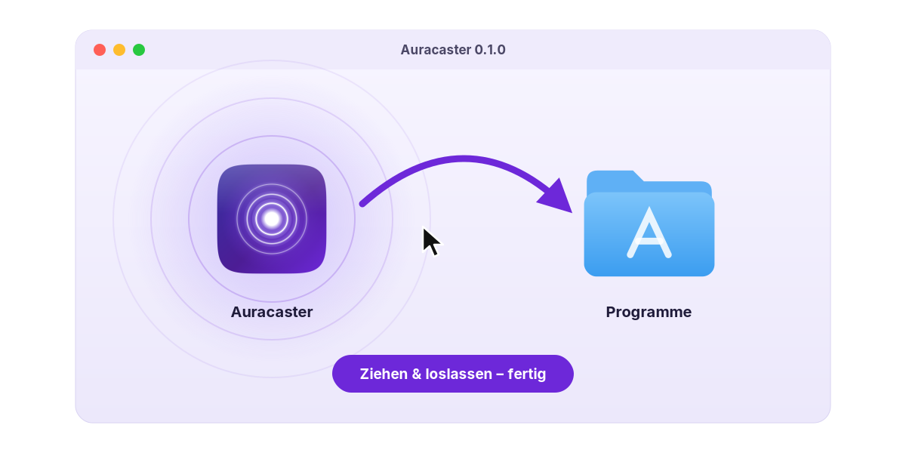</p>

### 3. Erster Start – und was macOS fragt

Auracaster aus **Programme** starten (oder <kbd>⌘</kbd>+<kbd>Leertaste</kbd> → „Auracaster“).

**„Auracaster“ kann nicht geöffnet werden / Apple konnte nicht überprüfen …** – das ist normal: Auracaster ist ein
kostenloses Open-Source-Projekt ohne kostenpflichtige Apple-Notarisierung. Einmalig freigeben, **ein** Weg reicht:

- **A – Systemeinstellungen (empfohlen):** Meldung mit *Fertig* schließen → **Systemeinstellungen → Datenschutz &amp; Sicherheit** →
  nach unten scrollen → bei *„Auracaster“ wurde blockiert* auf **Dennoch öffnen** → Passwort/Touch ID → nochmals **Dennoch öffnen**.
  (Seit macOS 15 funktioniert der alte Trick „Rechtsklick → Öffnen“ nicht mehr – dies ist der offizielle Weg.)
- **B – Gatekeeper-Fix:** `Gatekeeper-Fix.command` im DMG doppelklicken. Auch das Skript kommt aus dem Internet und muss evtl. erst wie bei A freigegeben werden.
- **C – Terminal:** `xattr -dr com.apple.quarantine /Applications/Auracaster.app && open /Applications/Auracaster.app`

<p align="center">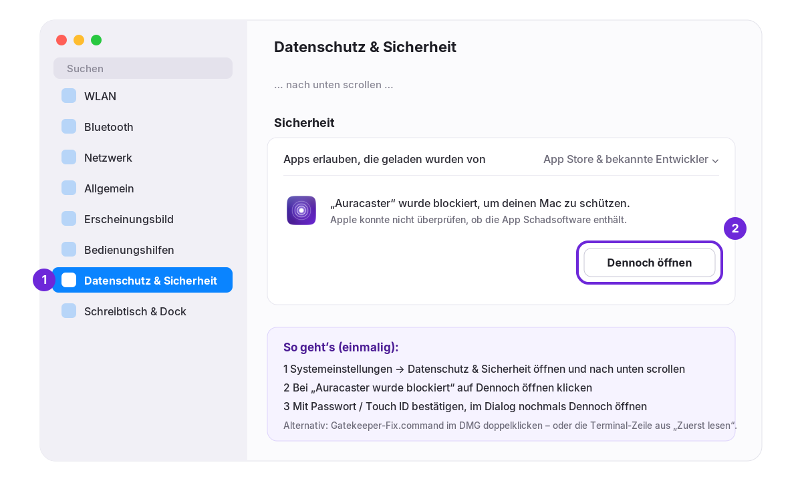</p>

Danach begrüßt dich der **Willkommens-Assistent**:

1. **Engine einrichten** klicken – lädt Python 3.12, Google Bumble und den LC3-Codec in `~/Library/Application Support/Auracaster` (ohne Xcode, ohne Homebrew, ca. 1–2 Minuten). Danach schaltet die App automatisch auf den Dongle um. Nach App-Updates richtet sie die Engine bei Bedarf selbst neu ein.
2. **Systemaudio erlauben** klicken (oder beim ersten **Senden**): macOS fragt nach **Systemaudio-Aufnahme** → **Erlauben**. Für Mikrofone/Audio-Interfaces kommt eine eigene Mikrofon-Abfrage.
   Nachträglich änderbar unter *Systemeinstellungen → Datenschutz &amp; Sicherheit → Bildschirm- &amp; Systemaudioaufnahme* bzw. *Mikrofon*.

Ohne Engine läuft Auracaster im **Simulationsmodus** – alles ist klickbar, aber es wird nicht gefunkt.

### 4. Dongle einrichten – macht die App

Im Willkommens-Assistenten (und jederzeit unter *Einstellungen → Dongle & Repeater → Dongle-Assistent*) wählst du die **Rolle**
(*Sender-Dongle* oder *Repeater*) und steckst das Board an. Der **Dongle-Assistent** erledigt den Rest: Bootloader starten,
`INFO_UF2.TXT` lesen, passende Firmware-Variante wählen, aufspielen, Version prüfen. Ohne Terminal, ohne Admin-Passwort
(macOS fragt einmal nach Zugriff auf *Wechseldatenträger*).

| Board | Was passiert | Taste nötig? |
|---|---|---|
| **Fabrikneu** (nur Bootloader, keine App) | startet direkt im Bootloader → Laufwerk erscheint → App flasht sofort | nein |
| **Auracaster ab 0.1.2** | App schickt es per Befehl in den Bootloader und aktualisiert | nein |
| **Arduino / CircuitPython** (Adafruit-Bootloader) | 1200-Baud-Touch → Bootloader → App flasht (Arduino: per seriellem DFU) | nein (auf echter Hardware noch ungetestet) |
| **Auracaster 0.1.0 / 0.1.1**, ZMK, Demo-Firmware | kein Fernzugang zum Bootloader – die App zeigt eine animierte Anleitung: **RST zweimal schnell an GND tippen**; sie erkennt das Laufwerk und macht weiter | **einmalig ja** |

<p align="center">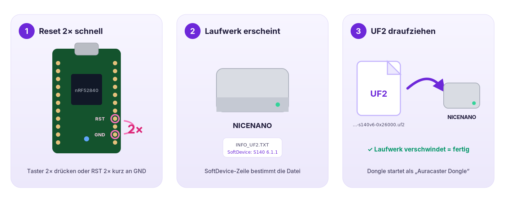</p>

<details><summary><b>Ohne App flashen (von Hand)</b></summary>

1. Dongle per USB-C an den Mac stecken und **zweimal schnell Reset** drücken. Hat dein Board keinen Taster: die Pins **RST** und **GND** zweimal kurz mit einer Pinzette/einem Draht verbinden.
2. Ein Laufwerk erscheint (meist **NICENANO**). Darin `INFO_UF2.TXT` öffnen und die Zeile **`SoftDevice:`** lesen.
3. Aus dem [neuesten Release](https://github.com/thegroovex/Auracaster/releases/latest) die passende Datei laden und **auf das Laufwerk ziehen**:

   | `SoftDevice:` in INFO_UF2.TXT | Datei |
   |---|---|
   | `S140 version 6.x` (häufigster Fall) | `auracaster-dongle-s140v6-0x26000.uf2` |
   | `S140 version 7.x` | `auracaster-dongle-s140v7-0x27000.uf2` |
   | `not found` | `auracaster-dongle-nosd-0x1000.uf2` |

   Für einen Repeater dieselbe Variante als `auracaster-repeater-….uf2`.
4. Das Laufwerk verschwindet von selbst (eine Meldung „nicht korrekt ausgeworfen“ ist harmlos). Die LED blinkt einmal pro Sekunde – der Dongle ist bereit.
</details>

Hintergründe (Bootloader, LED-Codes, Selbstbau der Firmware): [firmware/README.md](firmware/README.md).

### 5. Dongle einstecken

Auracaster erkennt den Dongle automatisch (Einstellung *Transport: auto*). Der Assistent und die Toolbar zeigen **„Auracaster Dongle erkannt“** bzw. *nRF52840*.
Sobald die App den Dongle benutzt, leuchtet die LED dauerhaft.

### 6. Ersten Stream starten

1. Die **Quelle** steht oben in der Toolbar – voreingestellt ist *Systemaudio* (alles, was der Mac abspielt). Alternativ eine **App** (auch Safari/Chrome; Apps, die gerade spielen, sind markiert) oder einen **Eingang** (Mikrofon/Interface).
2. Im Studio optional den **Namen** ändern (so heißt der Sender auf den Empfängern) und ein **Preset** wählen – *Ausgewogen* ist der empfohlene Standard.
3. Oben rechts **Senden** klicken – der Knopf wird rot: **On Air**.

### 7. Empfänger verbinden

- **Smartphone/Earbuds (Android, Samsung, Pixel):** *Einstellungen → Bluetooth → Auracast* (bzw. „Audio teilen/Broadcast suchen“) → Sender wählen – oder den **QR-Code** aus dem Studio mit der Kamera scannen.
- **Hörgeräte:** in der Hersteller-App die Auracast-/Broadcast-Suche öffnen und den Sender wählen.
- **Lautsprecher mit Auracast:** Auracast-/Broadcast-Taste bzw. Hersteller-App.

Lautstärke und Preset lassen sich jederzeit in der **Menüleiste** ändern.

### Updates

Auracaster prüft einmal täglich auf neue Versionen (abschaltbar in den Einstellungen) und zeigt dann ein **Update**-Abzeichen.
*Auracaster → Nach Updates suchen …* öffnet den Dialog mit den Neuerungen; **Jetzt aktualisieren** lädt die neue Version,
ersetzt die App und startet sie neu – ohne erneute Gatekeeper-Abfrage. Die App muss dazu im Ordner *Programme* liegen.

## Häufige Fragen &amp; Fehlerbehebung

<details><summary><b>„Auracaster ist beschädigt und kann nicht geöffnet werden“</b></summary>

Das ist die Quarantäne-Markierung, nicht eine echte Beschädigung. Terminal öffnen und ausführen:
`xattr -dr com.apple.quarantine /Applications/Auracaster.app` – oder den Terminal-Installer aus Schritt 1 benutzen.
</details>

<details><summary><b>Die App zeigt „Simulation“ statt des Dongles</b></summary>

Die Engine ist noch nicht eingerichtet: *Einstellungen → Engine-Installation → Engine einrichten* – danach schaltet die App von selbst um.
Unter *Einstellungen → Engine* muss *Bumble (USB-Dongle)* gewählt sein (die Simulation gibt es nur noch auf ausdrücklichen Wunsch).
</details>

<details><summary><b>„Engine beendet (Exit-Code 1)“ oder „Engine-Installation unvollständig“</b></summary>

Die Meldung zeigt jetzt die letzten Protokollzeilen. *Engine neu einrichten* (Knopf in der Meldung oder in den Einstellungen) behebt
eine kaputte/alte Installation – v0.1.0 installierte Bumble unvollständig (`cannot import name 'crypto'`). Für Fehlerberichte:
**Protokoll kopieren** und in ein GitHub-Issue einfügen.
</details>

<details><summary><b>„Kein Dongle gefunden“</b></summary>

- Anderes USB-C-Kabel probieren – viele Kabel laden nur und übertragen keine Daten.
- Erscheint beim Einstecken ein Laufwerk *NICENANO*, ist der Dongle im Bootloader: den Dongle-Assistenten öffnen – er flasht automatisch (Schritt 4).
- Blinkt die LED gar nicht, die Firmware noch einmal flashen (evtl. die andere SoftDevice-Variante).
- Im Terminal prüfen: `ls /dev/cu.usbmodem*` sollte einen Eintrag zeigen.
- *Einstellungen → Diagnose → Dongle prüfen* zeigt, ob der Controller antwortet (Version, ISO-Broadcaster, gefundene Ports).
- Ab Firmware 0.1.1 startet der Dongle neu, wenn die App die Verbindung schließt – die LED blinkt dann kurz, das ist normal.
</details>

<details><summary><b>Meine Kopfhörer finden den Sender nicht</b></summary>

Nicht jedes Bluetooth-Gerät kann Auracast – „Bluetooth 5.3“ allein reicht nicht, es braucht **LE Audio + Auracast/Broadcast-Empfang**.
Bei Earbuds läuft die Suche oft über das gekoppelte Smartphone (Android 15+/One UI 6+). Abstand testweise auf 1–2 m verkürzen.
</details>

<details><summary><b>Kein Ton / Ton stottert oder klingt „roboterhaft“</b></summary>

- **Firmware ab 0.1.2** (Dongle-Assistent) und Preset **Ausgewogen**. Bleibt es stumm: *Kompatibel* (24 kHz, Pflichtformat aller Empfänger).
- *Einstellungen → Diagnose* → **Bestätigt / Soll**: unter 95 % schafft der Dongle das Preset nicht (Funkzeit) → *Ausgewogen* oder *Übertragung → Mono senden*.
- Kleine Aussetzer: *Einstellungen → Übertragung → Stabilität* auf 60 oder 100 ms stellen (mehr Puffer, etwas mehr Verzögerung).
- *Ultra-Low β* (7,5 ms) spielen nicht alle Empfänger ab – Samsung-Handys synchronisieren teils, bleiben aber stumm.
- *Einstellungen → Diagnose*: „SDUs/s gesendet · bestätigt“ sollte bei Stereo/10 ms ≈ 200 · 200 sein; steigen *Unterläufe*, kommt zu wenig Audio vom Mac. „Aufnahme (Mac)“ sollte ≈ 100 % zeigen.
- **WAV-Mitschnitt vor dem Encoder** einschalten, kurz senden, Datei im Logs-Ordner anhören: klingt sie sauber, liegt das Problem auf der Funkstrecke, sonst bei der Aufnahme.
- WLAN im 2,4-GHz-Band und viele Bluetooth-Geräte in der Nähe kosten Funkzeit.
</details>

<details><summary><b>Systemaudio klingt doppelt / mit Echo</b></summary>

In 0.1.1 konnte „Systemaudio“ doppelt mit kleiner Verschiebung ankommen – vor allem mit virtuellen Audiotreibern (Pro Tools Audio Bridge,
AirBeamTV, Loopback …) oder Audio-Interfaces als Ausgabe. Ab 0.1.2 nimmt die App genau einen Tap am Standard-Ausgabegerät und schließt
Hilfsprozesse solcher Treiber aus. Tritt es trotzdem auf: *Einstellungen → Diagnose → Protokoll kopieren* (Zeile „Tap: …“) und als Issue melden.
</details>

<details><summary><b>Safari/Chrome als Quelle: „spielt gerade kein Audio“</b></summary>

Browser spielen Audio in Hilfsprozessen ab; Auracaster nimmt diese seit 0.1.1 mit auf. Die Meldung erscheint, wenn die App noch nie
Audio ausgegeben hat – Wiedergabe starten und erneut senden, oder einfach *Systemaudio* nehmen.
</details>

<details><summary><b>macOS fragt nach einem Update erneut nach Berechtigungen</b></summary>

Die Release-Builds sind ad-hoc signiert mit fester Kennung (`de.groovex.Auracaster`), damit Freigaben Updates normalerweise überleben.
Fragt macOS trotzdem erneut, einfach wieder *Erlauben*.
</details>

<details><summary><b>Wie deinstalliere ich Auracaster?</b></summary>

`Auracaster.app` aus *Programme* in den Papierkorb, dazu optional `~/Library/Application Support/Auracaster` (Engine) und `~/.local/bin/uv` löschen.
</details>

## Hardware, Firmware, Gehäuse

| | |
|---|---|
| [firmware/](firmware/README.md) | Zephyr-Firmware für den Pro Micro nRF52840: HCI über USB-CDC (H4), LE-Audio-Broadcast, +8 dBm, UF2 für drei Bootloader-Varianten – baut automatisch in der CI |
| [hardware/case/](hardware/case/README.md) | 3D-druckbares Gehäuse mit Halo-Relief (OpenSCAD, STL/3MF), Vorschauen unten |
| [macos/](macos/README.md) | SwiftUI-App: Architektur, Build mit Xcode/XcodeGen, Screenshot-Modus, Updater |
| [engine/](engine/auracaster_helper.py) | Python-Engine (Bumble + LC3), gesteuert per JSON Lines; [setup-engine.sh](engine/setup-engine.sh) richtet sie ein |

<p align="center">
  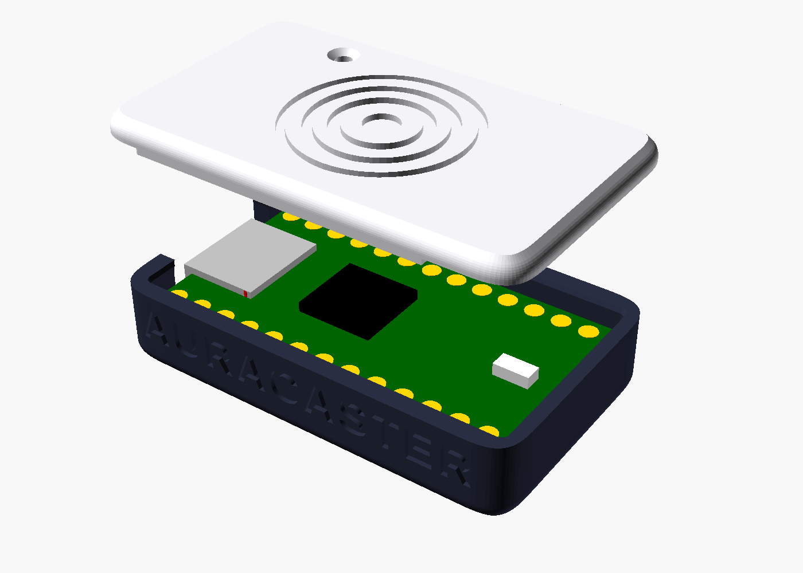
  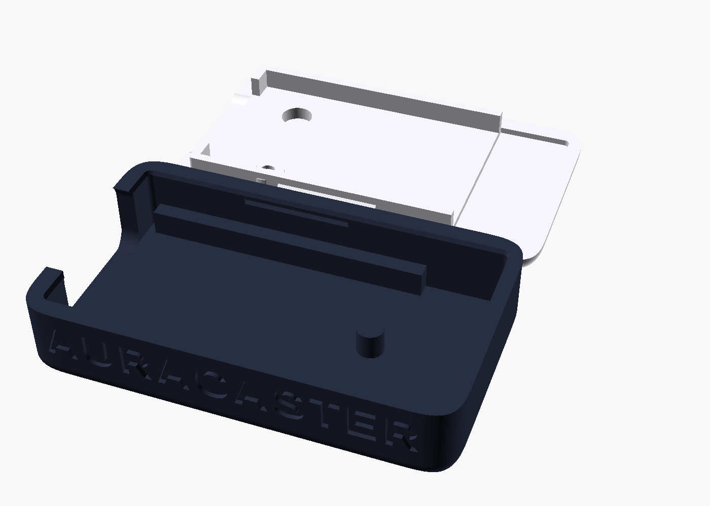
</p>

## Für Entwickler

```sh
git clone https://github.com/thegroovex/Auracaster && cd Auracaster
brew install xcodegen && (cd macos && xcodegen generate && open Auracaster.xcodeproj)
python3 -m venv .venv && .venv/bin/pip install -r engine/requirements.txt   # Engine aus dem Checkout
```

Jeder Push baut die App auf GitHub Actions (`macos-26`), erzeugt die Screenshots aus der App und ein DMG.
Ein Tag `v*` veröffentlicht automatisch ein Release mit DMG, ZIP und Firmware. Details: [macos/README.md](macos/README.md).

## Basiert auf Google Bumble

Die Funk-Engine von Auracaster ist [**Bumble**](https://github.com/google/bumble) von Google – ein vollständiger Bluetooth-Stack in Python
(Apache-2.0). Dieses Repository ist ein Fork; Bumble selbst liegt unverändert in [`bumble/`](bumble/), Upstream-Änderungen kommen
über den Remote `upstream`. Das ursprüngliche Bumble-README: [docs/BUMBLE_README.md](docs/BUMBLE_README.md).

Lizenz: Apache-2.0 ([LICENSE](LICENSE)). Auracast™ ist eine Marke der Bluetooth SIG, Inc.; dieses Projekt ist nicht von der Bluetooth SIG zertifiziert.

---

## English summary

**Auracaster** turns your Mac into an **Auracast™ (Bluetooth LE Audio broadcast) transmitter**: system audio, a single app or a microphone is
LC3-encoded and broadcast through a ~€5 nRF52840 USB dongle to any number of hearing aids, earbuds and speakers – targeting ≈ 20 ms latency.
**[Download the DMG](https://github.com/thegroovex/Auracaster/releases/latest/download/Auracaster-macOS.dmg)** (macOS 26+, Apple silicon), drag the app to
Applications, allow it once in *System Settings → Privacy & Security → Open Anyway*, click *Set up engine* in the welcome assistant, plug in the
dongle – the built-in dongle assistant installs the firmware (boards with firmware ≤ 0.1.1 need one double-tap of RST↔GND), press **Send**. Or install everything without Gatekeeper prompts:
`curl -fsSL https://raw.githubusercontent.com/thegroovex/Auracaster/main/macos/Installer/install.sh | bash`. Early version: one stream today,
more streams (languages) in progress. Built on [Google Bumble](https://github.com/google/bumble).
